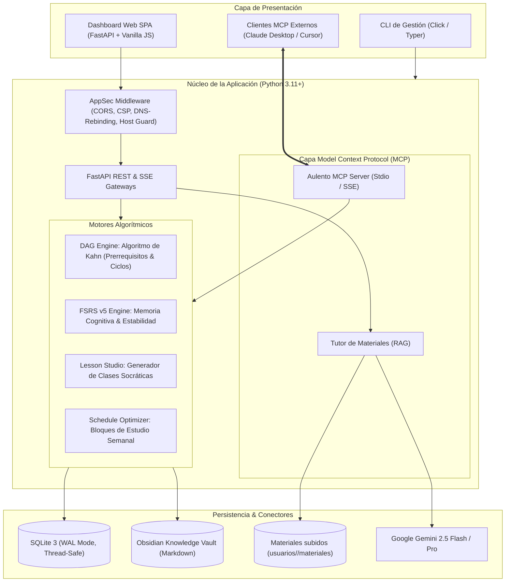
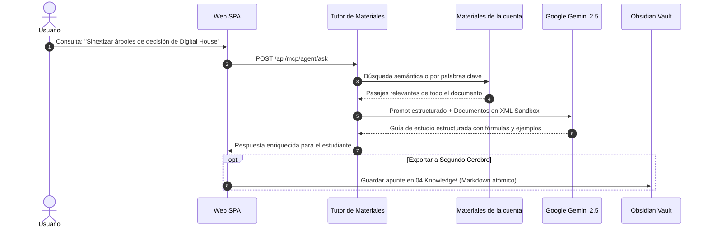

# Aulento 🧠⚡
### Intelligent Local-First Study Operating System & Academic Library RAG

[](https://python.org)
[](https://fastapi.tiangolo.com)
[](https://github.com/open-spaced-repetition/fsrs4anki)
[](https://modelcontextprotocol.io/)
[](https://ai.google.dev/)
[](tests/)
[](docker-compose.yml)
[](tests/test_cybersecurity_hardening.py)
[](https://localfirstweb.dev/)
[](LICENSE)

> **Aulento** es un sistema operativo de estudio personal **local-first**. En tu computadora corre en modo local: una sola persona, sin login ni cuentas. En la nube (`aulento.com`) corre con cuentas, una prueba de 15 días y un tutor flotante. Unifica rutas de aprendizaje autodirigidas mediante algoritmos de grafos topológicos, optimización cognitiva de memoria con **FSRS v5**, soporte multi-proveedor de IA (**Google Gemini**, **Anthropic Claude**, **OpenAI**), materiales de estudio (PDF, Markdown y texto) subidos desde la PC y leídos enteros por el tutor, un servidor y agente autónomo basado en el **Model Context Protocol (MCP)**, sincronización bidireccional con tu segundo cerebro en **Obsidian**, panel de administración y modo demo interactivo.

---

## 📑 Tabla de Contenidos
- [Por qué Aulento](#-por-qué-aulento)
- [Arquitectura del Sistema](#-arquitectura-del-sistema)
- [Pilares de Ingeniería](#-pilares-de-ingeniería)
  - [1. Grafo de Prerrequisitos Topológico (Algoritmo de Kahn)](#1-grafo-de-prerrequisitos-topológico-algoritmo-de-kahn)
  - [2. Motor de Repetición Espaciada FSRS v5](#2-motor-de-repetición-espaciada-fsrs-v5)
  - [3. Tutor sobre tus Materiales (RAG)](#3-tutor-sobre-tus-materiales-rag)
  - [4. Servidor MCP para Claude Desktop & Cursor](#4-servidor-mcp-para-claude-desktop--cursor)
  - [5. Sincronización Local-First & Obsidian](#5-sincronización-local-first--obsidian)
  - [6. Ciberseguridad Defensiva & AppSec Suite](#6-ciberseguridad-defensiva--appsec-suite)
- [Matriz Comparativa](#-matriz-comparativa)
- [Probalo en la nube](#-probalo-en-la-nube)
- [Inicio Rápido (Quickstart)](#-inicio-rápido-quickstart)
- [Modo local y modo nube](#-modo-local-y-modo-nube)
- [Configuración por cuenta](#configuración-por-cuenta)
- [Materiales de estudio subidos desde la PC](#-materiales-de-estudio-subidos-desde-la-pc)
- [Integración con Claude Desktop / Cursor (MCP)](#-integración-con-claude-desktop--cursor-mcp)
- [Documentación Completa](#-documentación-completa)
- [Pruebas y Calidad de Código](#-pruebas-y-calidad-de-código)
- [Estructura del Proyecto](#-estructura-del-proyecto)
- [Licencia](#-licencia)

---

## 💡 Por qué Aulento

Las plataformas tradicionales de estudio están fracturadas:
* **Anki** es excelente para memorizar tarjetas aisladas, pero carece de visión curricular, contexto de cursos y comprensión de prerrequisitos.
* **Notion u Obsidian** guardan notas pasivas que mueren en carpetas sin algoritmos activos de revisión ni retroalimentación estructurada.
* **Las carpetas de la PC o de Google Drive y OneDrive** acumulan cientos de PDFs y apuntes que rara vez se interconectan con tu sesión de estudio diaria.

**Aulento cierra este abismo:**
Transforma tus materiales de estudio y tus cursos en un **grafo de aprendizaje activo**, programa tus sesiones diarias según tus bloques de tiempo disponibles, calcula la curva de olvido óptima con **FSRS v5**, y te permite conversar con tus apuntes mediante agentes autónomos de Inteligencia Artificial que respetan el protocolo abierto **MCP**.

---

## 🏛 Arquitectura del Sistema

El sistema implementa una arquitectura limpia y modular desacoplada en capas:



---

## ⚡ Pilares de Ingeniería

### 1. Grafo de Prerrequisitos Topológico (Algoritmo de Kahn)
* Implementación matemática en `aulento.roadmap.graph_engine`.
* Modela temas y materias como un **Grafo Dirigido Acíclico (DAG)**.
* **Detección temprana de dependencias circulares**: Garantiza que ningún plan de estudio contenga bloqueos lógicos irresolubles.
* **Cálculo de Desbloqueo Dinámico**: Evalúa en tiempo de ejecución qué asignaturas tienen todos sus prerrequisitos completados para habilitar únicamente los siguientes pasos viables de aprendizaje.

### 2. Motor de Repetición Espaciada FSRS v5
* Implementado en `aulento.fsrs` y sincronizado en la interfaz web.
* Basado en la **Free Spaced Repetition Scheduler v5**, modelo matemático de última generación superior al tradicional SuperMemo SM-2.
* Modela cada concepto en función de **Retrievability ($R$)**, **Stability ($S$)** y **Difficulty ($D$)**.
* Optimiza los intervalos de repaso para minimizar la fatiga mental y maximizar la retención a largo plazo con target retention del 90%.

### 3. Tutor sobre tus Materiales (RAG)
* Tutor en `aulento.mcp.agent`, sobre los materiales que subió la cuenta (`aulento.core.materiales`).
* **Lectura completa**: el texto de cada PDF, Markdown o texto se guarda entero; el tutor toma los pasajes relevantes de cualquier parte del documento, con un tope total de contexto.
* **Búsqueda híbrida**: con pgvector usa búsqueda semántica; sin él, busca por palabras clave sobre el texto guardado en SQLite.
* **Respuestas aterrizadas**: guías, resúmenes y tarjetas basados en tus fuentes, con el documento delimitado contra prompt injection.



### 4. Servidor MCP para Claude Desktop & Cursor
* Implementación estándar bajo la especificación **Model Context Protocol (MCP)**.
* Expone las herramientas nativas de Aulento como herramientas estándar utilizables por cualquier LLM externo:
  * `study_courses`: Inspección y avance de cursos (Digital House, Coursera, Humai, etc.).
  * `study_books`: Registro y avance de lectura de libros técnicos.
  * `study_fsrs`: Consulta y evaluación de flashcards activas.
  * `study_schedule`: Horarios y cálculo de slots de estudio semanales.
  * `study_lessons`: Generación de lecciones pedagógicas.

### 5. Sincronización Local-First & Obsidian
* Arquitectura basada en principios **Local-First**: tu conocimiento te pertenece.
* Base de datos SQLite local con configuración `PRAGMA journal_mode=WAL` para máxima concurrencia y tolerancia a fallos.
* Integración nativa con **Obsidian**: escribe y lee notas en formato Markdown atómico con frontmatter YAML compatible con Dataview.

### 6. Ciberseguridad Defensiva & AppSec Suite
La aplicación está auditada mediante una suite de pruebas de seguridad adversarial (`tests/test_cybersecurity_hardening.py`):

| Vector de Ataque | Mitigación Implementada | Estado |
| :--- | :--- | :---: |
| **Fuga de Secretos en Git** | Reglas de exclusión estricta en `.gitignore` + gate pre-commit de escaneo criptográfico. | 🛡️ Blindado |
| **Path Traversal / Escape** | Toda ruta de nota se resuelve y se confina al vault de la cuenta; lo que sale responde 404. | 🛡️ Blindado |
| **Robo de Claves en Reposo** | Claves de IA y autorización de Google Play Libros cifradas por cuenta con una clave maestra del servidor. | 🛡️ Blindado |
| **Timing Attacks en Auth** | Comparación de tokens en tiempo constante mediante `hmac.compare_digest`. | 🛡️ Blindado |
| **DNS Rebinding & Host Injection** | `TrustedHostMiddleware` restringido a dominios locales autorizados. | 🛡️ Blindado |
| **CORS / CSRF Malicioso** | `LocalOriginAuthMiddleware` con bloqueo estricto de orígenes externos no verificados. | 🛡️ Blindado |
| **Clickjacking / MIME Sniffing** | Cabeceras de seguridad `X-Frame-Options: DENY`, `X-Content-Type-Options: nosniff`. | 🛡️ Blindado |
| **Prompt Injection** | Delimitación estricta de documentos no confiables mediante etiquetas XML `<documento>`, con el cierre neutralizado. | 🛡️ Blindado |
| **SQL Injection** | Repositorios 100% parametrizados sobre SQLite nativo sin concatenación de strings. | 🛡️ Blindado |

---

## 📊 Matriz Comparativa

| Característica | Aulento | Anki | Notion | LMS (Canvas / Coursera) |
| :--- | :---: | :---: | :---: | :---: |
| **Filosofía Local-First** | ✅ 100% local | ⚠️ Local / Sync cerrado | ❌ Cloud dependiente | ❌ Cloud cerrado |
| **Algoritmo de Memoria** | 🚀 **FSRS v5** | ⚠️ SM-2 legacy | ❌ No tiene | ❌ No tiene |
| **Grafo DAG de Prerrequisitos** | ✅ Algoritmo de Kahn | ❌ No tiene | ⚠️ Manual / Complejo | ⚠️ Secuencial rígido |
| **Protocolo Abierto MCP** | ✅ Server & Agent nativo | ❌ No tiene | ❌ No tiene | ❌ No tiene |
| **RAG sobre tus PDFs y apuntes** | ✅ Integrado, documento entero | ❌ No tiene | ❌ Requiere plugins pagos | ❌ No tiene |
| **Integración con Obsidian** | ✅ Bidireccional | ⚠️ Requiere community addons | ❌ No tiene | ❌ No tiene |
| **Protección AppSec Auditada** | ✅ 9 Vectores verificados | ❌ N/A | ⚠️ Gestionado por terceros | ⚠️ Gestionado por terceros |

---

## ☁️ Probalo en la nube

Entrá a **[aulento.com](https://aulento.com)**. La portada explica cada módulo, en español o en inglés, y ofrece:

- **Probar 15 días:** creás una cuenta con usuario y contraseña, sin código de invitación, correo ni tarjeta, y entrás directo. A los 15 días la cuenta deja de responder hasta que un administrador la extienda.
- **Ver demo:** una cuenta compartida con datos de ejemplo, de un clic.
- **Descargar e instalar:** los pasos para tenerlo en tu computadora. El código abierto se publica pronto.

Cada cuenta usa **su propia API key** de Gemini, Claude u OpenAI. La carga en **Configuración** y queda cifrada en el servidor.

---

## 🚀 Inicio Rápido (Quickstart)

### Requisitos Previos
* **Python 3.11+**
* **Git**

---

### ⚡ Opción A: Inicio en 1 Clic (Recomendado)

Aulento incluye scripts de auto-arranque que comprueban que Python sea 3.11 o posterior, crean el entorno virtual si no existe, instalan las dependencias (y las reinstalan cuando cambia `requirements.txt`) y levantan el servidor en `127.0.0.1`, en el puerto 8000 o en el 8001 si el 8000 está ocupado. Arranca en **modo local**: entrás directo, sin cuenta ni contraseña. No necesitan Docker.

* **En Windows:**
  Haz doble clic en `start.bat` o ejecútalo desde tu terminal:
  ```cmd
  .\start.bat
  ```

* **En Linux / macOS:**
  ```bash
  chmod +x start.sh
  ./start.sh
  ```

#### 🧙‍♂️ Asistente Interactivo de Bienvenida (CLI Wizard)
Si prefieres configurar tu entorno paso a paso (sembrar tarjetas de inglés técnico, verificar API keys, etc.), corre el asistente de onboarding:
```bash
python -m aulento onboarding
```

---

### 🛠️ Opción B: Instalación Manual Paso a Paso

#### 1. Clonar el repositorio
```bash
git clone https://github.com/TU_USUARIO/aulento.git
cd aulento
```

#### 2. Configurar el entorno virtual e instalar dependencias
```bash
# Crear entorno virtual
python -m venv .venv

# Activar entorno (Windows)
.venv\Scripts\activate
# Activar entorno (Linux / macOS)
# source .venv/bin/activate

# Instalar dependencias del proyecto
pip install -r requirements.txt
pip install -e .
```

#### 3. Configurar variables de entorno
El servidor lee las variables del **entorno del proceso** que lo arranca; no carga ningún archivo `.env`. Definilas en la terminal, o en el servicio o la tarea que lo inicia:
```bash
export AULENTO_DATA_DIR=/ruta/a/los/datos        # PowerShell: $env:AULENTO_DATA_DIR = "D:\datos"
```
Todas son opcionales: `AULENTO_DATA_DIR` (dónde se guardan los datos), `AULENTO_SECRET_KEY` (la clave maestra que cifra los secretos) y `AULENTO_MODE` (`local` por defecto; `saas` para cuentas con login, ver [Modo local y modo nube](#-modo-local-y-modo-nube)). Las claves de IA **no** van en variables de entorno: cada cuenta carga la suya (ver [Configuración por cuenta](#configuración-por-cuenta)).

#### 4. Iniciar el servidor web
```bash
aulento web start --port 8000
```
Abre tu navegador en: **`http://127.0.0.1:8000`** 🎉

---

### 🐳 Opción C: Búsqueda Semántica con Docker & pgvector (Opcional)

Aulento opera de forma autónoma con SQLite. Para habilitar **Búsqueda Semántica en Lenguaje Natural** (RAG) sobre tus cursos, libros y notas mediante embeddings de Gemini (`text-embedding-004`, 768 dimensiones) y PostgreSQL:

```bash
docker compose up -d
```

- **Motor:** `pgvector/pgvector:pg16` en el puerto `5432`.
- **Persistencia:** Volumen local Docker `study_engine_pgdata`.
- **Búsqueda:** Índice HNSW con métrica de distancia coseno (`<=>`).
- **Uso:** En la Web UI, tocá **«Indexar todo»** para indexar el contenido de tus materiales y de Mis notas (lo que no cambió se saltea) y preguntá con **«Preguntar»**: el tutor combina coincidencia por palabras y por vectores y cita de dónde sale cada parte. También disponible para agentes mediante la tool MCP `study_semantic_search`.
- **Por cuenta:** cada fragmento indexado pertenece a la cuenta que lo indexó, y buscar, contar y reindexar alcanzan solo los propios. Si el contenedor es de una versión anterior, la columna de dueño se agrega sola en el primer uso; volvé a indexar el catálogo.

---


---

## 🔐 Modo local y modo nube

El mismo motor corre de dos formas (ADR 017):

| | Modo local (por defecto) | Modo nube (`AULENTO_MODE=saas`) |
| :--- | :--- | :--- |
| Quién | Una sola persona, en su computadora | Varias cuentas en un servidor |
| Ingreso | Directo, sin login | Usuario y contraseña; prueba de 15 días o invitación |
| Dónde escucha | Solo en el bucle local (`127.0.0.1`, `localhost`, `::1`): con otro host o con un proxy declarado **no arranca** | Detrás de HTTPS (ver la guía de despliegue) |
| Qué suma | — | Portada, prueba de 15 días, tutor flotante, visor del vault y telemetría |

Un valor desconocido de `AULENTO_MODE` frena el arranque. Todo lo que sigue en esta sección es del **modo nube**.


### Cada cuenta, sus datos

Cada cuenta ve y modifica solo sus cursos, libros, agenda, tarjetas, rutas y registros, en la web, en la CLI y en el servidor MCP. Un administrador no ve los datos de estudio de otras cuentas. Si venís de una versión anterior, **la primera cuenta que se crea recibe todos los datos que ya tenías**; el detalle de la migración está en la [guía de base de datos](docs/GUIA_BASE_DE_DATOS_Y_BACKUPS.md).

- **La CLI opera como una cuenta.** Con una sola cuenta activa no cambia nada. Con varias, indicá cuál con la opción global `--user` (va antes del comando) o con la variable `AULENTO_USER`; si no, los comandos de datos terminan con un error que lo explica y no tocan nada:
  ```bash
  aulento --user ana books list
  AULENTO_USER=ana aulento fsrs status
  ```
  `db`, `user` y `web` funcionan sin indicar cuenta.
- **El arranque ya no siembra datos.** Una cuenta nueva empieza sin plataformas, rutas ni tarjetas. Sembrar es una operación de la cuenta y no afecta a las demás:
  ```bash
  aulento --user ana db init        # las 5 plataformas y el mazo de inglés técnico
  aulento --user ana fsrs seed      # solo el mazo
  aulento --user ana roadmap seed   # las rutas de plantilla
  ```
  Con la sesión iniciada, lo mismo por la API: `POST /api/fsrs/seed` y `POST /api/roadmap/templates/seed`. El asistente `aulento onboarding` también siembra para la cuenta.
- **Tokens MCP por cuenta.** Para conectar un cliente MCP por red, cada cuenta usa su propio token (ver [Integración MCP](#-integración-con-claude-desktop--cursor-mcp)).

> [!WARNING]
> **Para exponer el servidor fuera de tu máquina hacen falta el modo nube (`AULENTO_MODE=saas`) y `AULENTO_SECRET_KEY`.** En modo local se niega a escuchar fuera del bucle local (`127.0.0.1`, `localhost`, `::1`), porque no tiene login. En modo nube, escuchando fuera del bucle local, no arranca sin la clave maestra: si no, la clave maestra se generaría junto a la base, y quien copiara todo el directorio de datos leería los secretos de todas las cuentas. El despliegue con HTTPS (Docker Compose y Caddy) está en la guía de despliegue. Las decisiones están en los ADR 004, 006, 007 y 008.

---

## Configuración por cuenta

Además de sus datos de estudio, cada cuenta tiene su propia configuración. Nada de esto se comparte, y un administrador no ve la de otra cuenta.

| Qué | Desde la web | Desde la terminal |
| :--- | :--- | :--- |
| **Proveedores de IA** (Gemini, Anthropic y OpenAI): proveedor activo, claves y modelos | Configuración | `aulento ia status`, `ia set-provider`, `ia set-key`, `ia set-model`, `ia test` *(y `fsrs gemini-config`)* |
| **Materiales de estudio** (PDF, Markdown y texto; 200 MB por cuenta) | Cerebro & Tutor IA > Mis materiales | `aulento vault list-materials` |
| **Prompts de sistema** de rutas y de clases | Configuración | — |
| **Usuario de Duolingo** | Sí | `aulento duolingo set-user <usuario>` |
| **Vault** de notas | Por la API (ver abajo) | `aulento vault location`, `vault seed-samples` |

- **Los secretos se guardan cifrados** en la base (claves de Gemini, Anthropic y OpenAI y autorización de Google Play Libros) y nunca vuelven en una respuesta: de cada uno se ve solo si está cargado y sus últimos cuatro caracteres.
- **Sin clave propia no hay IA.** Una cuenta que no cargó su clave recibe el aviso de que falta configurarla; no usa la de otra cuenta ni una del servidor.
- **Sin usuario de Duolingo no se consulta nada.** El código no trae ninguno por defecto.
- **Una cuenta sin prompts propios usa los predeterminados**, y restablecerlos vuelve a ellos.

### El vault de cada cuenta

Las notas, clases, apuntes y resúmenes de una cuenta se escriben en su vault, dentro del directorio de datos del servidor (`usuarios/<id>/vault/`), y solo ella los lista, lee y busca.

- **Descargarlo:** `GET /api/vault/export.zip`, con la sesión iniciada, baja el vault completo como `.zip`. En la nube también hay un visor del vault en la web.
- **Notas de muestra:** un vault nuevo empieza vacío. `aulento vault seed-samples` (o `POST /api/vault/sample-notes`) copia las de muestra.
- **Usar una carpeta de Obsidian** (solo administradores, solo su propia cuenta): `aulento vault location --set <carpeta>` apunta el vault a una carpeta existente de la máquina del servidor; `--clear` vuelve al propio; sin opciones muestra cuál se usa. La carpeta no puede ser, contener ni estar dentro del directorio de datos ni de la carpeta donde vive la base. Si después deja de existir, o pasa a llevar a una de esas carpetas, las operaciones del vault fallan con un mensaje que lo dice, en vez de escribir en otro lado.
- **Rutas de lo guardado:** cuando una operación guarda una nota, la respuesta dice dónde quedó con su ruta **dentro del vault** (por ejemplo `04 Knowledge/Cursos/…`), no con la ruta del disco del servidor.

### Clave maestra y respaldo

Los secretos se cifran con una clave maestra del servidor: la de `AULENTO_SECRET_KEY` o, si no está definida, una que se genera sola en `clave_maestra.key`, dentro del directorio de datos, con el archivo restringido a quien corre el servidor (en Windows, sin los permisos heredados de la carpeta; si no se pudo restringir, el servidor lo avisa). Para generar una:

```bash
python -c "from cryptography.fernet import Fernet; print(Fernet.generate_key().decode())"
```

El respaldo completo es **la base, la clave maestra y la carpeta `usuarios/`** (con el vault y los materiales subidos de cada cuenta). Sin la clave maestra los secretos no se recuperan: cada cuenta vuelve a cargarlos. El detalle está en la [guía de base de datos](docs/GUIA_BASE_DE_DATOS_Y_BACKUPS.md).

### Variables que ya no se leen

Daban una clave, una credencial o una carpeta a toda la instalación. El servidor las ignora: quitalas del entorno del proceso que lo arranca (la terminal, el servicio o la tarea programada) y de la configuración de tus clientes MCP.

`GEMINI_API_KEY` · `GEMINI_PAID_API_KEY` · `GEMINI_MODEL` · `GDRIVE_CREDENTIALS_PATH` · `GDRIVE_ROOT_FOLDER_ID` · `AULENTO_VAULT_PATH` · `OBSIDIAN_VAULT_PATH` · `AULENTO_MCP_CONFIG_PATH` · `AULENTO_DUOLINGO_CACHE`

Tampoco se leen los archivos sueltos del directorio de datos (`gemini_key*.txt`, `mcp_config.json`, `gdrive_token.json`, el del cliente OAuth, `prompts/`, `duolingo_cache.json`, `vault/`).

### Si venís de una versión anterior

La primera cuenta que se crea recibe sola lo que había en esos archivos, y solo ella: una cuenta posterior, aunque sea administradora, no los recibe sin pedirlos. Si tu cuenta ya existía, o tu vault de Obsidian estaba en otra carpeta, pedilo desde una terminal del servidor:

```bash
aulento user import-files <usuario> --vault <carpeta> --from <carpeta-con-los-archivos>
```

- `--vault` es opcional y solo para una cuenta administradora: registra esa carpeta como su vault, sin moverla.
- `--from` es opcional: recorre esa carpeta en vez del directorio de datos del servidor (por ejemplo, una copia de los datos anteriores). El respaldo queda dentro de ella.

El comando carga lo que la cuenta no tiene, no pisa nada y se puede repetir: si se corta a mitad, otra pasada termina lo que faltó. Los archivos ya cargados quedan en `importado-<fecha>/`, dentro de la carpeta recorrida, **con las claves en claro**: borrá esa carpeta cuando compruebes que todo funciona. Una clave de IA que vivía solo en una variable de entorno no se importa: cargala desde Configuración.

---

## 📚 Materiales de estudio subidos desde la PC

Aulento no se conecta con Google Drive ni con OneDrive (ADR 015). Si tus apuntes están ahí, bajalos de Drive (o de OneDrive, o de un USB) y subilos: en la web, pestaña **Cerebro & Tutor IA** > **Mis materiales** > **Subir materiales**.

- **Formatos:** PDF, Markdown (`.md`, `.markdown`) y texto (`.txt`). Los PDF escaneados (sin texto) y los `.docx` no se admiten: exportalos a PDF con texto.
- **Topes:** 25 MB por archivo y 200 MB por cuenta. Borrar un material libera su espacio.
- **Dónde quedan:** en el servidor, en `usuarios/<id>/materiales/` dentro del directorio de datos, y solo los ve la cuenta que los subió.
- **Quién los usa:** el tutor (lee el documento entero y toma los pasajes que tienen que ver con la pregunta), la cosecha de tarjetas (`aulento fsrs harvest --source materiales`), los apuntes del vault (`aulento vault list-materials` y `vault note-from-material`) y MCP (`materials_search` y `materials_read`).

---

## 🤖 Integración con Claude Desktop / Cursor (MCP)

Puedes conectar Aulento directamente a tu asistente de IA de escritorio agregándolo a tu archivo de configuración MCP (`claude_desktop_config.json`):

```json
{
  "mcpServers": {
    "aulento": {
      "command": "python",
      "args": [
        "-m",
        "aulento",
        "--user",
        "tu_usuario",
        "mcp",
        "serve"
      ],
      "env": {
        "AULENTO_DATA_DIR": "C:/Users/TU_USUARIO/.aulento"
      }
    }
  }
}
```

El servidor MCP opera siempre como una cuenta y solo ve y modifica los datos de esa cuenta. La clave de IA y los materiales que usa son los de esa cuenta: no van en la configuración del cliente.

- **Por STDIO** (el ejemplo de arriba) es la de `--user` o `AULENTO_USER`; con una sola cuenta activa podés omitirla. Si no se puede determinar, el servidor no arranca.
- **Por red** (`aulento mcp serve --transport http`) es la dueña del token de cada pedido. Los tokens se crean, listan y revocan por cuenta:
  ```bash
  aulento mcp token create ana --name "Claude Desktop"   # muestra el token una única vez
  aulento mcp token list
  aulento mcp token revoke 3
  ```
  Con la sesión iniciada, cada cuenta gestiona los suyos por la API: `GET`, `POST` y `DELETE /api/mcp/tokens`.

El token único de versiones anteriores (`~/.aulento/mcp_auth_token.txt`) **dejó de valer**: creá uno para tu cuenta y reemplazalo en tus clientes. La [guía MCP](docs/GUIA_MCP.md) tiene el paso a paso.

*Ahora puedes pedirle a Claude o Cursor en tu IDE:*
> *"¿Cuáles son mis tarjetas pendientes de repetición en Aulento?"*  
> *"Revisa mis clases de Digital House y dime qué prerrequisitos me faltan para empezar Redes Neuronales."*

---

## 📚 Documentación Completa

La documentación del sistema vive en `docs/` y cuenta con verificación automatizada anti-deriva frente al código fuente:

- **[Manual de Usuario](docs/MANUAL_DE_USUARIO.md):** Guía interactiva de la interfaz web SPA, primer ingreso, asistente de onboarding, cuenta demo y detalle de las 10 pestañas del panel lateral.
- **Guía de Administración:** Manual operativo para administradores: primer admin en consola, gestión de cuentas e invitaciones, restablecimiento de contraseñas, variables de entorno `AULENTO_*` y advertencias sobre la clave maestra.
- **[Referencia de la API REST](docs/REFERENCIA_API.md):** Catálogo exhaustivo de los endpoints de la API, modelo de autenticación por cookies `se_sesion`, defensa anti-CSRF por origen, rutas públicas y catálogo de códigos de error HTTP.
- **[Referencia de la CLI](docs/REFERENCIA_CLI.md):** Documentación completa de los comandos de la CLI (`aulento ...`), opción global `--user` y selección de cuenta activa vía `AULENTO_USER`.
- **[Guía del Servidor MCP](docs/GUIA_MCP.md):** Conexión con Claude Desktop / Cursor, autenticación por tokens de cuenta, materiales subidos (`materials_search` y `materials_read`) y tabla de referencia con las herramientas MCP disponibles.
- **Guía de Despliegue:** Despliegue en producción con Docker Compose, proxy inverso Caddy con HTTPS automático, reglas de exposición según ADR 013 y almacenamiento y respaldo de los materiales subidos.
- **[Guía de Base de Datos y Backups](docs/GUIA_BASE_DE_DATOS_Y_BACKUPS.md):** Mantenimiento de bases SQLite, migraciones, copias de seguridad en caliente y restauración.

Consulta el **Índice de Documentación** para una visión detallada de todos los documentos y guías técnicas.

---

## 🧪 Pruebas y Calidad de Código

El proyecto cuenta con una cobertura exhaustiva de pruebas unitarias, de integración, de grafos, de aislamiento multicuenta y de ciberseguridad:

```bash
# Ejecutar la suite completa de pruebas
pytest

# Ejecutar auditoría adversarial de ciberseguridad
pytest tests/test_cybersecurity_hardening.py -v

# Ejecutar pruebas del motor de grafos DAG (Kahn)
pytest tests/test_prerequisite_graph.py -v

# Ejecutar pruebas del tutor sobre materiales
pytest tests/test_mcp_agent.py -v

# Ejecutar suite de pruebas de documentación y anti-deriva
pytest tests/test_documentacion.py -v
```

---

## 📁 Estructura del Proyecto

```text
aulento/
├── .github/workflows/          # Integración Continua (CI verify.yml)
├── docs/                       # Especificaciones arquitectónicas, manuales y bitácoras
│   ├── adr/                    # Decisiones de Arquitectura (ADRs)
│   ├── api/                    # Esquema canónico openapi.json
│   ├── product/                # PRD & Product Discovery
│   ├── GUIA_ADMINISTRACION.md  # Manual de administración y variables de entorno
│   ├── GUIA_BASE_DE_DATOS_Y_BACKUPS.md # Gestión de base de datos y respaldos
│   ├── GUIA_DESPLIEGUE.md      # Puesta en producción con Docker y Caddy HTTPS
│   ├── GUIA_MCP.md              # Manual completo del protocolo MCP y herramientas
│   ├── MANUAL_DE_USUARIO.md    # Manual de la interfaz web SPA (10 pestañas)
│   ├── REFERENCIA_API.md       # Catálogo de endpoints de la API REST
│   ├── REFERENCIA_CLI.md       # Catálogo de comandos de consola
│   └── README.md               # Índice general de la carpeta de documentación
├── src/aulento/           # Código fuente principal
│   ├── audio/                  # Tutor de voz con Gemini
│   ├── cli/                    # Comandos de consola Click/Typer
│   ├── core/                   # Gateway de IA, exposición, secretos, extensiones y eventos
│   ├── db/                     # Capa de datos SQLite y repositorios
│   ├── fsrs/                   # Algoritmo de repetición espaciada v5
│   ├── mcp/                    # Servidor MCP y tutor sobre materiales
│   ├── models/                 # Modelos de dominio Pydantic
│   ├── roadmap/                # Motor de grafos DAG Kahn y Lesson Studio
│   ├── vault/                  # Adaptador de integración con Obsidian
│   └── web/                    # API FastAPI y frontend SPA (Vanilla JS + CSS)
├── tests/                      # Suite de pruebas automatizadas
│   ├── test_cybersecurity_hardening.py  # Pruebas adversariales AppSec
│   ├── test_documentacion.py            # Pruebas anti-deriva de documentación
│   ├── test_prerequisite_graph.py       # Pruebas de grafos DAG
│   ├── e2e/                             # Navegador (Playwright): AULENTO_E2E=1 pytest tests/e2e
│   └── ...
├── pyproject.toml              # Definición de paquete y dependencias
├── requirements.txt            # Dependencias fijadas
└── setup.sh                    # Script de configuración y hooks de Git
```

---

## 📄 Licencia

Este proyecto está bajo la Licencia [MIT](LICENSE) — Siéntete libre de utilizarlo, bifurcarlo y adaptarlo a tu propio sistema de estudio.

---
<p align="center">
  Diseñado con estándares de ingeniería de software moderna, algoritmos cognitivos y soberanía de datos.
</p>
