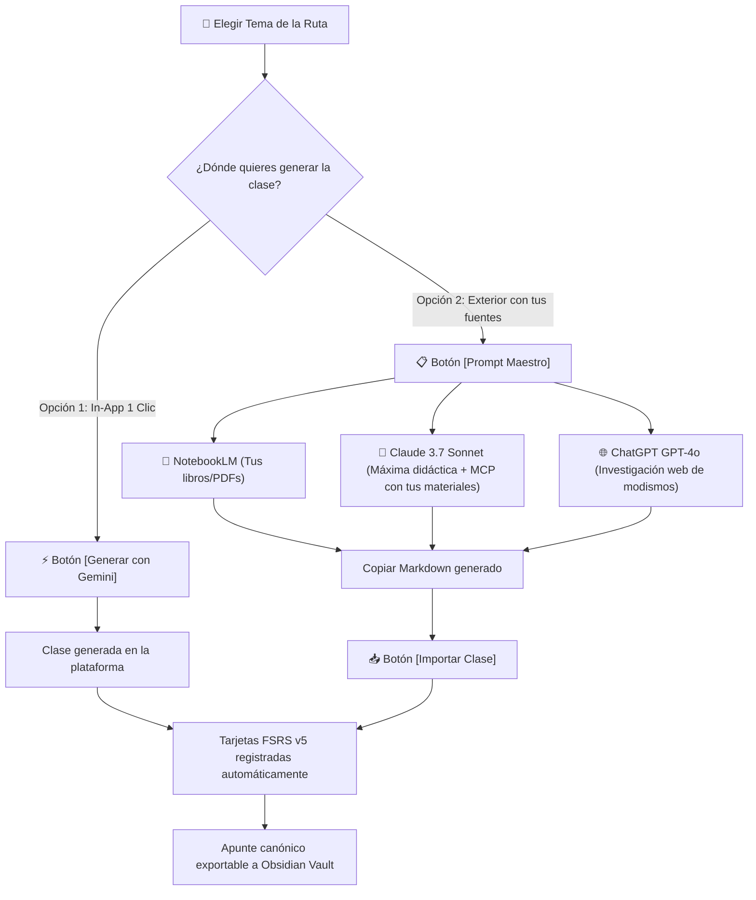

# Guía de Rutas, Clases y Selección de Modelos IA

Esta guía documenta la arquitectura bimodal de Aulento para la creación de **Rutas de Aprendizaje**, la elaboración de **Clases Magistrales** y la elección del modelo de inteligencia artificial óptimo según tu objetivo de estudio.

---

## 1. Arquitectura Bimodal: Dos Formas de Estudiar

Aulento opera bajo un principio de soberanía y flexibilidad del estudiante:



---

## 2. Selección de Modelos: ¿Cuál me conviene para cada etapa?

### A. Para Diseñar la Ruta (Módulos y Temas)
* **Recomendado:** `gemini-2.5-flash` o `gemini-2.5-flash-lite`.
* **Motivo:** La creación de la malla curricular es una tarea estructural. Gemini Flash genera el árbol de temas en menos de 3 segundos, consume mínimos tokens y tiene límites de cuota gratuitos muy generosos en Google AI Studio.

---

### B. Para Generar el Contenido de la Clase (Master Prompt)

El generador de clases adapta dinámicamente el prompt según el área de estudio (Idiomas, Negocios o Tecnología). La elección del modelo externo depende de **dónde residen tus fuentes de información**:

| Escenario de Estudio | Modelo Recomendado | Ventaja Principal y Razón |
| :--- | :---: | :--- |
| **Tienes libros o apuntes en PDF** *(ej. English Grammar in Use de Cambridge, manuales O'Reilly)* | **NotebookLM** | **Cero alucinaciones y grounding exacto.** Al cargar tus libros en un cuaderno y pegar el prompt, la explicación se extrae fielmente de la bibliografía de los autores. |
| **Buscas la máxima excelencia pedagógica y formato estricto** *(Inglés Profesional, Arquitectura)* | **Claude 3.5 / 3.7 Sonnet** ⭐ *(Recomendado General)* | **El rey de la didáctica y respeto estructural.** Genera de forma impecable los pares mínimos fonéticos, los callouts de Obsidian (`[!tip]`, `[!warning]`), los diálogos de roleplay y el bloque exacto ````cards-fsrs````. Si usas Claude Desktop con el servidor MCP de Aulento, puede buscar y leer los materiales que subiste (`materials_search` y `materials_read`). |
| **Necesitas investigar modismos actuales y tendencias en internet** | **ChatGPT (GPT-4o)** | Su motor de navegación web consulta foros reales, foros de ingeniería y diccionarios actualizados (Cambridge/Merriam-Webster) para incorporar lenguaje vivo de Silicon Valley. |
| **Generación directa sin salir de la plataforma** | **Gemini 2.5 Flash / Pro** | Inmediatez con el botón `[⚡ Generar con Gemini]`. |

---

## 3. Preguntas Frecuentes sobre APIs y Configuración

### ¿Qué proveedores de IA soporta Aulento para ejecución in-app?
Aulento soporta tres proveedores mediante una capa neutral de pasarela (ADR 009):
1. **Google Gemini:** `gemini-2.5-flash`, `gemini-2.5-flash-lite`, `gemini-2.5-pro` y modelos de voz/audio.
2. **Anthropic:** `claude-opus-5-5`, `claude-sonnet-5-5`, `claude-haiku-5-5`.
3. **OpenAI:** `gpt-4o`, `gpt-4o-mini`, embeddings con `text-embedding-3-small`.

### ¿Cómo selecciono el proveedor y modelo que usa mi cuenta?

#### Opción 1: Desde la Interfaz Web (Recomendada)
1. Ve a la pestaña **Configuración** (`⚙️`) en la barra de navegación.
2. En la sección **Proveedores de IA**, elige tu **Proveedor Activo** (`Gemini`, `Anthropic` u `OpenAI`).
3. En la tarjeta de cada proveedor puedes cargar tu clave (guardada cifrada con Fernet), elegir el modelo preferido o consultar en vivo la lista de modelos disponibles mediante el botón de refresco.
4. Cada tarjeta cuenta con un botón **Probar conexión** para verificar credenciales y latencia sin salir de la pantalla.

#### Opción 2: Desde la terminal (CLI)
```bash
# Ver estado de proveedores de tu cuenta:
aulento ia status

# Seleccionar proveedor activo:
aulento ia set-provider anthropic

# Cargar una clave de API (cifrada):
aulento ia set-key anthropic --key sk-ant-...

# Fijar modelo preferido o listar modelos disponibles:
aulento ia set-model anthropic claude-sonnet-5-5
aulento ia models anthropic

# Probar conexión:
aulento ia test anthropic
```

Las claves y modelos son independientes por cada cuenta y se almacenan cifrados en la base de datos relacional. Los comandos anteriores de Gemini (`aulento fsrs gemini-config`) se conservan por compatibilidad hacia atrás.

---

## 4. Perfil Pedagógico por Disciplina, Arquetipos y Alcance de la Ruta

Las clases ya no asumen el molde de ingeniería. Cada ruta lleva un **perfil pedagógico** que describe cómo se enseña su disciplina, y el Prompt Maestro se arma con él. La decisión de diseño está en el ADR 001.

### El Prompt Maestro en tres capas

[`LessonPromptBuilder`](../src/aulento/roadmap/prompt_builder.py) compone el prompt así:

1. **Núcleo fijo** (igual para toda materia): encabezado `# <tema>`, explicación con Técnica Feynman, callouts de Obsidian `[!tip]` / `[!warning]` y, si las tarjetas están activadas, el bloque ```` ```cards-fsrs ```` con pares `Q:` / `A:`.
2. **Perfil pedagógico de la ruta**: rol y tono docente, secciones de la clase en orden, tipo de fuentes a consultar y flashcards de ejemplo. El código y los diagramas Mermaid solo se piden si el perfil los usa.
3. **Contexto del tema**: módulo, nivel objetivo, enfoque de estudio, descripción y los títulos del tema anterior y siguiente.

Si el destino es **Gemini in-app** (botón `[⚡ Gemini]`), el prompt no incluye directivas de búsqueda en tus materiales ni de investigación web —ese modelo no tiene herramientas en esta sesión— y pide explícitamente que no se inventen citas.

### Opciones de contenido del Prompt Maestro

El modal **Opciones del Prompt** suma interruptores que agregan pedidos al prompt. Apagados, el prompt no los menciona.

| Opción (campo de la API) | Qué pide |
|---|---|
| 🖼️ Figuras generadas (`include_visuals`) | Entre 2 y 4 figuras como bloques ```` ```svg ```` autocontenidos (con `viewBox`, sin scripts ni recursos externos), cada una con su pie de figura. |
| 🎞️ Diapositivas de repaso (`include_slides`) | Un bloque ```` ```slides ```` de 6 a 10 diapositivas separadas por `---`, cada una con título `#` y de 3 a 5 viñetas. |
| ✅ Autoevaluación (`include_quiz`) | 5 preguntas de opción múltiple numeradas, con opciones `a)` a `d)` y una sección de soluciones explicadas. |
| 📚 Glosario y bibliografía (`include_glossary`) | Glosario de términos clave y lecturas recomendadas, sin inventar títulos, autores ni enlaces. |
| 🔗 Puente (`include_bridge`) | Abrir con un repaso breve del tema anterior y cerrar con qué sigue; en el primer o el último tema de la ruta se omite la mitad que no aplica. |
| Profundidad (`depth`) | `breve` (600–900 palabras), `estandar` (1500–2500, por defecto) o `exhaustiva` (3500 o más). Otro valor devuelve HTTP 422. |

Las secciones opcionales se numeran después de las del perfil, en este orden: glosario, autoevaluación, diapositivas. El bloque de tarjetas FSRS sigue siendo siempre la última sección.

Las "imágenes" son **figuras SVG** escritas por el modelo de texto, no archivos de imagen: funcionan igual en NotebookLM, Claude, ChatGPT y Gemini. La autoevaluación no usa los prefijos `Q:` / `A:` / `Pregunta:` / `Respuesta:` porque el importador los interpreta como flashcards cuando falta el bloque `cards-fsrs`.

Las mismas opciones viajan en el cuerpo (opcional) de `POST /api/roadmap/topics/{id}/generate-lesson`, así que también valen para el botón `[⚡ Gemini]`. La generación in-app sigue sin pedir búsquedas y siempre pide las tarjetas FSRS, se envíe lo que se envíe. La CLI y la herramienta MCP `study_get_topic_master_prompt` no exponen estas opciones.

### El visor de clase

El visor tiene tres pestañas:

- **Vista previa** (por defecto): el Markdown renderizado con tablas, listas, énfasis, enlaces, imágenes y código. Dibuja los bloques `mermaid` como diagramas y los `svg` como figuras, muestra los callouts `[!tip]`, `[!warning]` y `[!note]` con estilo propio y oculta los bloques `cards-fsrs` y `slides`.
- **Markdown**: el texto original completo de la clase, con un botón para copiarlo.
- **Diapositivas**: aparece solo si la clase trae un bloque `slides`. Se avanza y retrocede con los botones o con las flechas ← → del teclado.

Todo el HTML de una clase pasa por un saneado antes de mostrarse: los scripts, los manejadores de eventos y las URLs `javascript:` que vengan en una clase generada o importada no se ejecutan. El render usa `marked` y `DOMPurify` desde el CDN jsDelivr; sin conexión, el visor muestra la clase como texto plano con un aviso.

### De dónde sale el perfil

| Origen | Cuándo |
|---|---|
| `ia` | La ruta se generó con IA y el modelo devolvió un perfil válido junto con los módulos. |
| `arquetipo` | No hubo IA, el perfil de la IA no validó, o la ruta es anterior a esta función (se resuelve al vuelo). |
| `editado` | Lo guardaste desde el botón **🎓 Perfil pedagógico** de la ruta. |

Puedes ver y editar el perfil de la ruta activa con **🎓 Perfil pedagógico** (entre 3 y 8 secciones). La API equivalente es `GET` / `PUT /api/roadmap/{id}/pedagogical-profile`.

### Arquetipos de respaldo

Viven en [`pedagogical_profiles.py`](../src/aulento/roadmap/pedagogical_profiles.py). El resolvedor compara **palabras completas** del título y del objetivo (nunca subcadenas) y las puntúa: las que nombran una disciplina pesan más que las de uso general. La categoría `general` (preseleccionada) no influye; una categoría técnica elegida suma a favor de `tech`. Es un respaldo para cuando no hay IA y puede equivocarse con títulos ambiguos: revisá el perfil desde el botón **Perfil pedagógico**.

| Arquetipo | Secciones de la clase |
|---|---|
| `tech` | Conceptos y analogía · diagrama de arquitectura · desarrollo técnico con código y mini-labs · buenas prácticas · caso real y preguntas de entrevista · conexiones sistémicas |
| `idiomas` | Gramática en contexto · colocaciones · fonética y pronunciación · roleplay · errores de hispanohablantes · ejercicios |
| `negocio` | Valor de negocio · diagrama de flujo de valor · frameworks y métricas · buenas prácticas · caso real · conexiones |
| `humanidades` | Problema y contexto · texto o autor primario · reconstrucción del argumento · objeciones y réplicas · vigencia y conexiones · pregunta de ensayo |
| `ciencias_sociales_salud` | Concepto y definiciones · teorías y autores · evidencia empírica y estudios clásicos · caso aplicado · consideraciones éticas · críticas, límites y replicabilidad |
| `ciencias_formales` | Intuición · definiciones formales · resultado principal y demostración · ejemplos resueltos · ejercicios graduados · errores típicos |
| `arte_hobby` | Qué es y por qué importa · contexto e historia · técnica o elementos clave · obras de referencia · práctica guiada |
| `general` | Concepto · desarrollo · ejemplos · aplicación práctica · errores comunes (cuando ninguna palabra coincide) |

### Alcance de la ruta

Al diseñar con IA eliges el tamaño (`--alcance` en la CLI):

| Alcance | Tamaño pedido a la IA |
|---|---|
| `curso` (por defecto) | 3–5 módulos de 3–4 temas |
| `especializacion` | 5–8 módulos de 4–6 temas |
| `carrera` | 8–14 módulos; cada módulo es una **materia** con su descripción y correlativas, sin temas |

En una carrera, los temas de cada materia se generan a demanda con **🌱 Expandir materia** (`POST /api/roadmap/modules/{id}/expand`): entre 4 y 8 temas, usando el perfil de la ruta. Sin IA disponible la expansión responde con un error y no inserta nada.

### Rutas generadas sin IA

Si no hay clave, se agotó la cuota o la respuesta no sirve, la ruta se construye desde el arquetipo de la disciplina y queda marcada con un **aviso** visible en la interfaz y en la CLI: es una estructura base genérica, no un plan a medida. Los prerrequisitos que devuelve la IA entre temas se guardan como prelaciones del grafo.

Las **plantillas curadas** se usan solo por elección explícita: el texto debe ser igual al título completo de la plantilla.

---

## 5. Grafo de Prelaciones

La vista **🕸️ Grafo de Prelaciones (DAG)** de una ruta dibuja qué tema hay que dominar antes de cuál. La decisión de diseño está en el ADR 002.

### Qué se ve

- **El grafo dibujado**: un nodo por tema, agrupados por módulo y coloreados por estado (dominado, en progreso, disponible, bloqueado), con la ruta crítica resaltada. Lo dibuja el Mermaid que sirve la propia app; si no carga o el dibujo falla, aparece un aviso y el tablero de tarjetas sigue funcionando.
- **Tres tipos de arista**:

| Arista | Dibujo | Bloquea | Se guarda |
| :--- | :--- | :--- | :--- |
| **Estricta** | línea continua | sí | sí |
| **Recomendada** | línea punteada | no | sí |
| **Inferida** (secuencia implícita) | línea gris discontinua | sí | no |

- **Qué estudiar ahora**: los temas sin completar cuyos prerrequisitos estrictos ya están dominados, en el orden de la ruta. Los de la ruta crítica llevan ⚡.
- **Ruta crítica**: la cadena más larga de prelaciones estrictas. Las recomendadas no cuentan.

### Secuencia implícita

Mientras el interruptor **Secuencia implícita** esté activado (lo está por defecto), cada tema que no tenga ninguna prelación **estricta** guardada entrante depende del tema anterior de la ruta (una recomendada no lo reemplaza). Esa arista se calcula al leer y no se guarda: agregar una prelación a mano le quita la inferida solo a ese tema, no al resto. Con el interruptor apagado, el grafo muestra únicamente las prelaciones guardadas. El ajuste vive en `metadata_json["grafo"]["secuencia_implicita"]` de la ruta.

### Editar desde el grafo

Al hacer clic en un tema se resaltan sus prerrequisitos y los temas que desbloquea, y se abre un panel con sus prelaciones entrantes y salientes. Desde ahí se puede **quitar** una prelación guardada, **cambiar su tipo** y **añadir una nueva** con ese tema ya elegido.

Al guardar, una prelación se rechaza si alguno de los temas no pertenece a la ruta o si origen y destino coinciden (HTTP 400), y si cerraría un ciclo con las ya guardadas (HTTP 409). Guardar una que ya existe actualiza su tipo.

### Sugerencias con IA

**✨ Sugerir prelaciones con IA** (`POST /api/roadmap/{id}/prerequisites/suggest`) le pide a Gemini las dependencias conceptuales entre los temas de una ruta de hasta 150 temas. No guarda nada: muestra las propuestas con su motivo y una casilla por cada una. Las que apuntan a temas inexistentes, se repiten, ya están guardadas o cerrarían un ciclo se descartan antes de mostrarlas. Al aceptar, las elegidas se guardan todas o ninguna (`POST /api/roadmap/{id}/prerequisites/bulk`), y se puede desactivar la secuencia implícita en el mismo paso, porque la propuesta describe el grafo completo. Sin IA disponible responde con un error y no propone nada. El motivo de cada sugerencia no se guarda.

### Exportar a Obsidian

**📋 Copiar Mermaid** copia el mismo código que dibuja la vista. Los títulos van escapados con entidades de Mermaid (`#quot;`, `#91;`, `#93;`…), así que un título con comillas o corchetes no rompe el diagrama.

---

## 6. El Flujo de Estudio en 3 Pasos

1. **Paso 1: Diseñar tu Ruta**
   * Abre **Rutas de Aprendizaje** ➔ Haz clic en **Diseñar con IA** (o elige una de las rutas canónicas del catálogo).
2. **Paso 2: Elaborar la Lección**
   * Elige un tema en el árbol curricular ➔ Pulsa **`[📋 Prompt Maestro]`**.
   * Activa los toggles según tus necesidades (Materiales, Investigación Web, Tarjetas FSRS, figuras, diapositivas, autoevaluación, glosario, puente) y elige la profundidad y el destino.
   * Pega el prompt en **NotebookLM** o **Claude 3.7 Sonnet**.
3. **Paso 3: Cerrar el Bucle**
   * Copia la respuesta en Markdown generada por la IA.
   * En Aulento, pulsa **`[📥 Importar Clase]`** y pega el contenido.
   * Al guardar, el tema se marca como completado, tus tarjetas se integran automáticamente al mazo **FSRS v5** para repaso espaciado y la nota queda lista para tu **Vault de Obsidian**.

### Librerías del visor

El visor usa `marked` (Markdown), `DOMPurify` (saneado) y `Mermaid` (diagramas), servidas por la propia app desde [`static/vendor/`](../src/aulento/web/static/vendor/README.md): funcionan sin conexión y no dependen de un CDN. Si por algún motivo no cargan, la clase se muestra como texto plano.

Si [⚡ Gemini] no logra generar la clase y el tema ya tenía una, la clase anterior se conserva.
